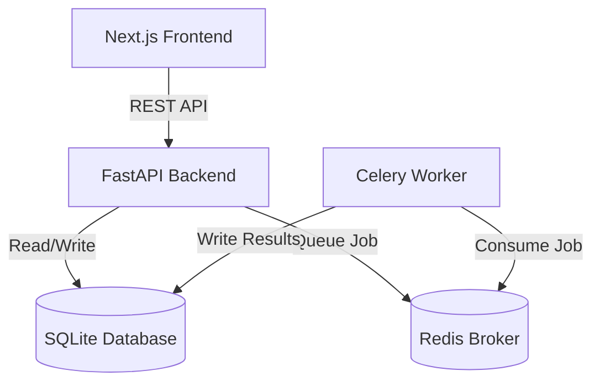
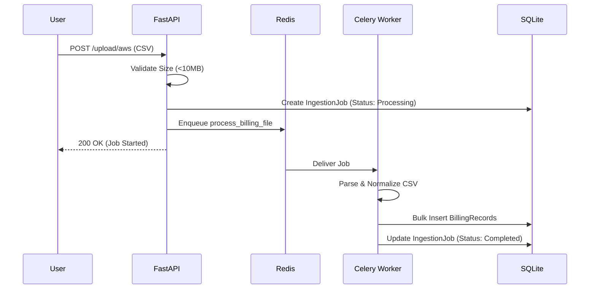

# CloudCost Sentinel

CloudCost Sentinel is a multi-cloud FinOps observability and analytics platform. Its core purpose is to help engineering and finance teams understand cloud expenditure, normalize billing data across providers, detect cost anomalies, and enforce budgets across AWS, Microsoft Azure, and Google Cloud Platform (GCP).

## Problem Statement & Motivation
Managing cloud spend across multiple providers often requires disjointed scripts or expensive proprietary SaaS solutions. CloudCost Sentinel provides a foundational, open-source approach to ingesting raw CSV billing exports from major cloud providers, normalizing the data into a unified relational schema, and exposing actionable insights through a modern Next.js dashboard and FastAPI backend.

**Intended Users:** Cloud Infrastructure Engineers, FinOps Practitioners, DevOps/DevSecOps Engineers.
**Status:** MVP / Portfolio Project. 
**Important Limitations:** The platform currently lacks Authentication/Authorization (RBAC) and operates safely only in local/isolated environments. It relies on batch ingestion rather than streaming live metrics.

---

## Table of Contents
- [CloudCost Sentinel](#cloudcost-sentinel)
  - [Problem Statement \& Motivation](#problem-statement--motivation)
  - [Table of Contents](#table-of-contents)
  - [Feature Breakdown](#feature-breakdown)
  - [Architecture](#architecture)
    - [Ingestion Lifecycle Sequence](#ingestion-lifecycle-sequence)
  - [Technology Stack](#technology-stack)
  - [Repository Structure](#repository-structure)
  - [Prerequisites](#prerequisites)
  - [Installation and Setup](#installation-and-setup)
    - [1. Clone and start Redis](#1-clone-and-start-redis)
    - [2. Backend \& Database Initialization](#2-backend--database-initialization)
    - [3. Start the FastAPI Server](#3-start-the-fastapi-server)
    - [4. Start the Celery Worker](#4-start-the-celery-worker)
    - [5. Start the Frontend](#5-start-the-frontend)
  - [Environment Variables](#environment-variables)
  - [Database and Migrations](#database-and-migrations)
  - [Billing Ingestion Guides](#billing-ingestion-guides)
    - [AWS (Cost and Usage Report)](#aws-cost-and-usage-report)
    - [Azure (Cost Management Export)](#azure-cost-management-export)
    - [GCP (BigQuery Export)](#gcp-bigquery-export)
  - [FinOps Calculations](#finops-calculations)
  - [API Reference](#api-reference)
    - [POST `/api/v1/upload/{provider}`](#post-apiv1uploadprovider)
    - [GET `/api/v1/costs`](#get-apiv1costs)
    - [GET `/api/v1/costs/history`](#get-apiv1costshistory)
    - [GET `/api/v1/ingestions`](#get-apiv1ingestions)
    - [POST `/api/v1/anomalies/detect`](#post-apiv1anomaliesdetect)
  - [Frontend Guide](#frontend-guide)
  - [Background Jobs and Redis](#background-jobs-and-redis)
  - [Testing and Quality Assurance](#testing-and-quality-assurance)
  - [CI/CD and Infrastructure](#cicd-and-infrastructure)
  - [Security and Privacy](#security-and-privacy)
  - [Troubleshooting](#troubleshooting)
  - [Contribution \& Governance](#contribution--governance)
  - [Roadmap](#roadmap)
  - [Disclaimer](#disclaimer)

---

## Feature Breakdown

| Feature | Status | Description |
| :--- | :--- | :--- |
| **AWS CUR Ingestion** | Implemented | Parses standard Cost and Usage Report CSVs. |
| **Azure Cost Export Ingestion** | Implemented | Parses Azure Cost Management CSV exports. |
| **GCP BigQuery Export Ingestion**| Implemented | Parses GCP standard BigQuery billing export CSVs. |
| **Billing Normalization** | Implemented | Unifies date ranges, provider IDs, and service names. |
| **Cost Aggregations** | Implemented | Calculates totals and historical trends via API. |
| **Budget Tracking** | Implemented | Compares actuals to monthly goals by provider/service. |
| **Anomaly Detection** | Implemented | 7-day rolling average threshold detection via Celery worker. |
| **Ingestion Job Tracking** | Implemented | Tracks asynchronous Celery job success/failure states. |
| **Dashboard Views** | Implemented | Next.js interface for Overviews, Budgets, and Anomalies. |
| **Database Persistence** | Implemented | SQLAlchemy ORM using SQLite (fallback from PostgreSQL). |
| **Authentication/RBAC** | Unverified | Explicitly out of scope for MVP. |

---

## Architecture

CloudCost Sentinel utilizes a decoupled architecture where a Next.js frontend communicates with a FastAPI Python backend. Heavy lifting (CSV parsing and rolling-average anomaly detection) is delegated to Celery workers mediated by Redis.



### Ingestion Lifecycle Sequence


---

## Technology Stack

* **Frontend:** Next.js 16+, React 18, TypeScript, Tailwind CSS, Recharts.
* **Backend:** Python 3.11, FastAPI.
* **Database & ORM:** SQLite (configured for local deployment), SQLAlchemy 2.0, Alembic (Migrations).
* **Asynchronous Processing:** Celery, Redis (Broker).
* **Testing:** Pytest, Fastapi TestClient, in-memory SQLite pools.
* **Infrastructure:** GitHub Actions (CI). Docker/Terraform configs exist but are fallback-disabled for local development.

---

## Repository Structure

```text
cloudcost-sentinel/
├── backend/
│   ├── alembic/              # Database migration scripts
│   ├── app/
│   │   ├── api/              # FastAPI endpoints (endpoints.py)
│   │   ├── core/             # Configuration (config.py)
│   │   ├── db/               # Session management
│   │   ├── models/           # SQLAlchemy models (billing.py, finops.py)
│   │   ├── services/         # Ingestion adapters (aws.py, azure.py, gcp.py)
│   │   └── worker/           # Celery tasks (tasks.py)
│   ├── tests/                # Pytest suites (test_adapters.py, test_api.py)
│   ├── requirements.txt
│   └── alembic.ini
├── frontend/
│   ├── src/
│   │   ├── app/              # Next.js App Router (page.tsx, layout.tsx)
│   │   ├── components/       # UI Components (Overview.tsx, ui/card.tsx)
│   ├── package.json
│   └── next.config.ts
├── docs/                     # Audit and report documentation
├── docker-compose.yml        # (Optional) Container stack
└── README.md
```

---

## Prerequisites

* **Node.js**: v18+ (verified with npm)
* **Python**: v3.11+
* **Redis**: Must be running locally on `localhost:6379`. (On Windows, WSL or Memurai can be used).
* **Operating System**: macOS, Linux, or Windows (PowerShell supported).

---

## Installation and Setup

Follow these exact steps to run the complete stack locally without Docker.

### 1. Clone and start Redis
Ensure Redis is running locally.
```bash
git clone https://github.com/TejasPatil-TP/cloudcost-sentinel.git
cd cloudcost-sentinel
# Ensure redis is running in the background, e.g., `redis-server`
```

### 2. Backend & Database Initialization
Open a terminal for the backend:
```powershell
cd backend
python -m venv venv
.\venv\Scripts\activate   # Or `source venv/bin/activate` on Unix
pip install -r requirements.txt

# Run migrations to initialize the SQLite database
$env:PYTHONPATH="."
alembic upgrade head
```

### 3. Start the FastAPI Server
In the same backend terminal:
```powershell
uvicorn app.main:app --port 8000 --reload
```

### 4. Start the Celery Worker
Open a **second** terminal for the Celery worker:
```powershell
cd backend
.\venv\Scripts\activate
$env:PYTHONPATH="."
# For Windows, use the solo pool via standard python execution:
python -m celery -A app.worker.celery_app worker -l info --pool=solo
# On Linux/macOS: celery -A app.worker.celery_app worker -l info
```

### 5. Start the Frontend
Open a **third** terminal:
```powershell
cd frontend
npm install
npm run dev
```

You can now access the application at **http://localhost:3000**.
Stop all processes cleanly using `Ctrl+C`.

---

## Environment Variables

The application relies on sensible defaults for local development.

| Variable | Purpose | Required | Default |
| :--- | :--- | :--- | :--- |
| `DATABASE_URL` | SQLAlchemy connection string | No | `sqlite:///./cloudcost.db` |
| `REDIS_URL` | Celery broker URL | No | `redis://localhost:6379/0` |
| `NEXT_PUBLIC_API_URL` | Frontend pointer to API | No | `http://localhost:8000/api/v1` |

*(Note: Never commit real production database URIs or credentials to the `.env` file.)*

---

## Database and Migrations

CloudCost Sentinel uses **Alembic** to manage SQLite schema changes.
* `BillingRecord`: Stores normalized line-item cost data.
* `Budget`: Stores defined thresholds per provider.
* `Anomaly`: Stores detected cost spikes.
* `IngestionJob`: Tracks the state of async file processing.

**Migrations:**
* Create a new migration: `alembic revision --autogenerate -m "Message"`
* Apply migrations: `alembic upgrade head`

If testing locally, deleting `cloudcost.db` and running `alembic upgrade head` will give you a clean slate. No destructive rollbacks are implemented automatically.

---

## Billing Ingestion Guides

The ingestion engine supports batch CSV processing. Files are parsed via Python Pandas inside the Celery worker.

### AWS (Cost and Usage Report)
* **Required Schema**: `Identity/LineItemId`, `lineItem/ProductCode`, `lineItem/UsageStartDate`, `lineItem/UsageEndDate`, `lineItem/UnblendedCost`.
* **Synthetic Sample (`test_e2e_aws.csv`)**:
```csv
Identity/LineItemId,lineItem/ProductCode,lineItem/UsageStartDate,lineItem/UsageEndDate,lineItem/UnblendedCost
123,AmazonEC2,2023-10-01T00:00:00Z,2023-10-01T01:00:00Z,1.50
```

### Azure (Cost Management Export)
* **Required Schema**: `SubscriptionId`, `MeterCategory`, `Date`, `CostInBillingCurrency`, `BillingCurrencyCode`.

### GCP (BigQuery Export)
* **Required Schema**: `billing_account_id`, `service.description`, `usage_start_time`, `usage_end_time`, `cost`, `currency`.

**Importing via API:**
```bash
curl -X POST -F "file=@test_e2e_aws.csv" http://localhost:8000/api/v1/upload/aws
```
*Note: The system currently uses basic bulk insertion. Advanced PostgreSQL-specific `ON CONFLICT` duplicate handling is disabled for SQLite compatibility.*

---

## FinOps Calculations

**Cost Aggregation:** Line items are grouped by provider and usage start date. All currencies are currently ingested as raw numerical values (currency conversion is a planned roadmap item).

**Anomaly Detection (7-Day Rolling Average):**
The `detect_anomalies` Celery task calculates the average daily spend per provider and service over the preceding 7 days. If a single day's cost exceeds **150% (1.5x)** of that historical average, it is flagged as a mathematical anomaly and persisted to the database for UI review.

*Note: The platform does not currently support predictive forecasting.*

---

## API Reference

The backend exposes the following REST API endpoints. OpenAPI documentation is automatically available at `http://localhost:8000/docs`.

### POST `/api/v1/upload/{provider}`
* **Purpose**: Upload a billing CSV for async processing.
* **Params**: `provider` (aws, azure, gcp). Form-data file.
* **Error**: 413 if file exceeds 10MB. 400 if provider is invalid.
* **Response**: `{"info": "file 'test.csv' saved and processing started"}`

### GET `/api/v1/costs`
* **Purpose**: Retrieve aggregate lifetime costs grouped by provider.
* **Response**: `[{"provider": "aws", "total_cost": 4.5}]`

### GET `/api/v1/costs/history`
* **Purpose**: Retrieve daily time-series total costs for dashboard charts.

### GET `/api/v1/ingestions`
* **Purpose**: Retrieve the last 5 async celery jobs and their success/fail states.

### POST `/api/v1/anomalies/detect`
* **Purpose**: Manually trigger the 7-day rolling average detection background task.

---

## Frontend Guide

The Next.js application provides several primary views:
* **Dashboard (`/`)**: Displays top-level KPI cards and a historical spending bar chart.
* **Data Ingestion (`/ingestion`)**: UI form to select a provider and upload a CSV file to the API.
* **Budgets (`/budgets`)**: Displays active budget thresholds.
* **Anomalies (`/anomalies`)**: Lists flagged provider spikes.

**Development Commands:**
* `npm run lint`: Validates ESLint rules.
* `npm run build`: Executes strict TypeScript type-checking and generates a production-ready static build.

---

## Background Jobs and Redis

Celery is used to ensure the FastAPI server remains responsive during heavy pandas CSV processing.
* Jobs are tracked in the `ingestion_jobs` table.
* **Troubleshooting**: If ingestions stay in a `processing` state indefinitely, ensure your Celery worker is actively running and connected to Redis on port 6379. 

---

## Testing and Quality Assurance

The project maintains a rigorous standard of testing.
* **Backend Tests**: Run `pytest tests/` in the `backend/` directory.
  * The test suite uses an isolated `StaticPool` in-memory SQLite database (`sqlite:///:memory:`) to ensure local developer databases are not destroyed during testing.
* **Frontend Tests**: Run `npm run lint` and `npm run build` in the `frontend/` directory to verify strict type safety.
* **Validation**: All tests, builds, and end-to-end integration flows (upload -> celery -> db -> frontend) have been manually verified and pass successfully.

---

## CI/CD and Infrastructure

* **GitHub Actions**: `.github/workflows/ci.yml` runs `pytest` and Next.js builds on every push to `main`.
* **Terraform**: Scaffolding exists in `infrastructure/terraform/` but should not be executed without explicit operational approval. It provisions zero resources by default.
* **Docker**: A `docker-compose.yml` file exists for production-style deployment (combining FastAPI, Postgres, Redis, and Celery), but local documentation focuses on bare-metal execution to accommodate constrained dev environments.

---

## Security and Privacy

**WARNING: Authentication and Authorization (RBAC) are intentionally NOT implemented in this MVP.**

* This application MUST NOT be exposed to the public internet in its current state.
* Billing files may contain proprietary architectural details and sensitive financial data.
* **Mitigations**: The API strictly enforces a **10MB file size limit** on CSV uploads to prevent basic DoS attacks on the Pandas parsing engine.
* Do not rely on file limits as a substitute for true network isolation and identity management.

---

## Troubleshooting

* **`OperationalError: no such table`**: You forgot to run `alembic upgrade head`.
* **Celery Worker fails to start on Windows**: Use `python -m celery ... --pool=solo` as standard Celery forking is unsupported on native Windows.
* **Upload fails instantly**: Check if the file is over 10MB.
* **Frontend says "Loading..." forever**: Ensure `NEXT_PUBLIC_API_URL` points to the correct running FastAPI port and CORS origins are respected.
* **Database wiped unexpectedly**: Ensure you do not run tests against the primary database URI. Tests are configured to use an in-memory db.

---

## Contribution & Governance

* Create feature branches off `main`.
* Ensure `pytest` and `npm run build` pass perfectly before submitting a Pull Request.
* Maintain strict TypeScript interfaces (avoid `any` types).
* This project is open-source. Please open an issue for major architectural changes.

---

## Roadmap

**Planned:**
* [ ] Implement OAuth2 / OIDC Authentication.
* [ ] PostgreSQL specific `ON CONFLICT` duplicate handling.
* [ ] Multi-currency conversion normalization.
* [ ] Automated Slack/Email notifications for anomalies.

---

## Disclaimer

**CloudCost Sentinel is a portfolio/MVP project.**
All local demonstrations run on synthetic, localized data. The application does **not** connect directly to live AWS/Azure/GCP APIs or incur cloud charges automatically.
